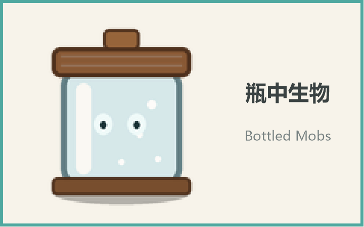

<div align="center">



**把生物封进玻璃罐，摆出来，再慢慢折腾。**

Minecraft 1.21.1 · NeoForge 21.1.252 · Java 21

[](https://github.com/Civinar-Riley/bottledmobs/actions/workflows/build.yml)

</div>

---

## 这是什么

一个独立实现的 NeoForge 模组。手持空瓶对生物右键或左键，把它封进罐子；罐子可以放出生物，也可以作为方块摆出来。摆出来的罐子能换外壳、调大小、调高度、拆掉外壳当玩偶，还能用书与笔把整套展示设置复印到别的罐子上。

玩法灵感来自 firis-games 的 MobBottle。本模组没有使用原模组的代码、贴图或语言文件。

## 特性

| 操作 | 效果 |
| :--- | :--- |
| 空瓶对生物右键 / 左键 | 捕获生物，生物数据写入物品，实体被移除 |
| 手持已装罐的罐子对地面右键 | 在点击位置放出生物，罐子恢复为空 |
| 潜行时对地面右键 | 把罐子放置为方块 |
| 手持任意方块右键已放置的罐子 | 瓶身外观替换为该方块（生存模式消耗该方块） |
| 手持瓶中生物右键已放置的罐子 | 罐内为空时装入生物；已有生物时恢复默认玻璃罐外观 |
| 命名牌右键已放置的罐子 | 重命名瓶内生物；物品名、提示、浮动名牌和放出后的名字同步 |
| 比较器读取罐子 | 按瓶内最高最大生命输出 1–15 级信号 |
| 红石脉冲 | 开启配置后释放瓶内生物，罐子和展示设置保留 |
| 剑右键 | 拆除外壳，只展示生物 |
| 木棍右键 | 切换玩偶模式（原尺寸、无外壳、贴地）与默认展示 |
| 锄 / 斧右键 | 放大 / 缩小生物，默认 0.1–3.0 倍，可在服务端配置中调整 |
| 镐 / 铲右键 | 升高 / 降低生物，默认 0–1 格、每下 1/16 格，可在服务端配置中调整 |
| 书与笔右键 | 把当前展示设置复印成一本成书 |
| 成书右键 | 把书里记录的设置粘贴到该罐子 |
| 空手右键 | 旋转罐子朝向 90° |
| 潜行 + 空手右键 | 恢复默认外壳、大小、高度，朝向对玩家 |
| 带乘客的生物 | 连同乘客一起装进罐子；鸡骑士、蜘蛛骑士有专属名 |
| `/bottledmobs give <targets> <entity> [name]` | 权限 2 的管理员命令，直接发一个装满指定生物的瓶子 |

- 物品名显示瓶内生物，随客户端语言实时解析；命名牌自定义名优先。整组捕获时提示会列出所有乘客。
- 新捕获或放置的生物默认 0.3 倍大小，可用锄/斧调整。
- 展示动画默认关闭；关闭时模型保持静止，开启后缓慢旋转并播放模型动画。
- 鱼和其他水栖生物在罐中按游动姿态摆放，不会侧躺。
- 破坏、爆炸、中键复制都会保留瓶内生物和展示设置；捕获新生物时展示设置恢复默认。
- 简体中文、繁体中文、英文三种语言。

### 命名与变种

- 命名牌右键已放置的罐子，改的是瓶内生物的名字；物品名、Tooltip、罐子上方浮动名牌和放出后的生物都会同步。生存模式消耗命名牌，创造模式不消耗。
- 变种从生物 NBT 读取，内置规则覆盖美西螈、猫、狐狸、鹦鹉、兔子、羊、潜影贝、马、羊驼、哞菇、熊猫、青蛙、史莱姆/岩浆怪、村民职业和狼变种。物品名显示物种与变种，Tooltip 另列物种、年龄、水生/发光状态。
- 鳕鱼、鲑鱼、热带鱼、河豚、鱿鱼、发光鱿鱼、美西螈、蝌蚪、海龟、海豚、守卫者、远古守卫者和青蛙在默认玻璃罐中显示水体与低频气泡；自定义外壳和玩偶模式不显示水。
- 烈焰人、岩浆怪、发光鱿鱼、悦灵、恼鬼和监守者会按内置规则发出方块光。
- 变种与发光规则都是内置 JSON（`data/bottledmobs/bottledmobs/variants/`、`.../glow/glow.json`），客户端/服务端从 mod jar 加载；数据包热改不在支持范围。

### 整组与成就

- 服务端配置 `capturePassengerStacks` 默认开启；开启时对载有乘客的生物（如骷髅骑蜘蛛）右键或左键，会把整组一起封入罐中，方块和物品里都会递归渲染乘客。关闭后恢复旧行为：骑乘中或载有乘客都无法捕获。
- 只处理乘客栈，不处理载具：正骑在别的生物上的目标仍然无法捕获，乘客里出现玩家也会拒绝。
- 8 个成就共用一个自定义 criterion trigger，位于独立的“瓶中生物”成就页签：第一瓶、收藏家、微缩、巨物、玩偶模式、全都上船、水族馆、夜灯。每玩家记录已捕获物种，死亡后保留。
- `data/bottledmobs/tags/entity_type/uncapturable.json` 默认空；把实体类型加进去就能禁止捕获（根和乘客都会检查）。命令绕过该 tag。
- 安装 Jade 后，指向已放置的罐子会显示名字/变种/年龄、整组数量、缩放/高度、玩偶模式、水生/发光；不装 Jade 正常启动，Jade 只是编译期依赖，不会打包进 jar。

## 合成

```text
 W
GBG
GGG
```

- `W`：任意木质台阶
- `G`：任意常见玻璃方块（`c:glass_blocks`）
- `B`：玻璃瓶

产物为 1 个空的瓶中生物。

空瓶方块（罐子的默认外壳，也可直接摆放）另有配方：

```text
G G
G G
 S
```

- `G`：任意常见玻璃方块
- `S`：任意木质台阶

产物为 1 个空瓶。

## 安装

- Minecraft **1.21.1** + NeoForge **21.1.252**（21.1.x 系列）
- 客户端与服务端都需要安装
- 从 [Releases](https://github.com/Civinar-Riley/bottledmobs/releases) 下载 `bottledmobs-neoforge1.21.1-1.4.5.jar`
- 把 jar 放进 `mods` 文件夹

## 配置

### 客户端

`config/bottledmobs-client.toml`：

```toml
[general]
    # 展示中的生物是否旋转并播放模型动画（默认关闭，关闭时姿态静止）
    animateCapturedMobs = false
```

### 服务端

`config/bottledmobs-server.toml`：

```toml
[display]
    # 新捕获/放置生物的默认缩放
    defaultScale = 0.3
    # 缩放范围与每次锄/斧的变化量
    minScale = 0.1
    maxScale = 3.0
    scaleStep = 0.1
    # 高度范围（格）与每次镐/铲的变化量
    minHeight = 0.0
    maxHeight = 1.0
    heightStep = 0.0625
```

缩放允许 0.01–16.0，高度允许 0–4.0。`min` 写得比 `max` 大时会自动互换。

```toml
[interaction]
    # 收到红石上升沿时释放瓶内生物（默认关闭）
    redstoneRelease = false
    # 捕获生物时连同其乘客一起装罐（默认开启）
    capturePassengerStacks = true
```

## 限制

- 开了 `capturePassengerStacks` 才能整组捕获；正骑在别的生物上的目标无法捕获，乘客里有玩家也不行。
- 缩放与高度范围由服务端配置决定，默认缩放 0.1–3.0 倍、高度 0–1 格。
- 水栖水体只在默认玻璃罐显示；自定义外壳和玩偶模式不显示水。
- 每个已放置的罐子每帧都要渲染一个完整实体；一次摆出大量罐子（尤其放大展示时）会明显增加客户端开销。
- 变种与发光规则内置 JSON，修改后需重新打包，不支持数据包热改。
- 命名牌与用于换壳的方块在生存模式都会消耗；不提供清除名字，再贴一张命名牌覆盖。
- 红石释放按上升沿触发，一直通电不会反复释放；释放后罐子保留，可重新装入。
- `uncapturable` 默认空；末影龙、凋灵等仍可被装走，需要时自行把实体类型加进 tag。
- Jade 是可选依赖；构建时需要访问 `api.modrinth.com/maven`，发布 jar 不含 Jade 代码。
- 与旧 MobBottle 的物品和存档不兼容（mod id 不同，方块与物品是全新的）。

## 从源码构建

需要 JDK 21：

```bash
./gradlew build
```

产物位于 `build/libs/bottledmobs-neoforge1.21.1-<版本号>.jar`。

## 授权

本模组代码与美术资源以 **MIT** 许可发布，见 [LICENSE](LICENSE)。构建脚本来自 NeoForge MDK 的部分遵循 [TEMPLATE_LICENSE.txt](TEMPLATE_LICENSE.txt)。

## 致谢

- 玩法灵感：[firis-games/MobBottle](https://github.com/firis-games/MobBottle)
- 模组加载器与构建工具链：NeoForge 与 NeoGradle 团队
